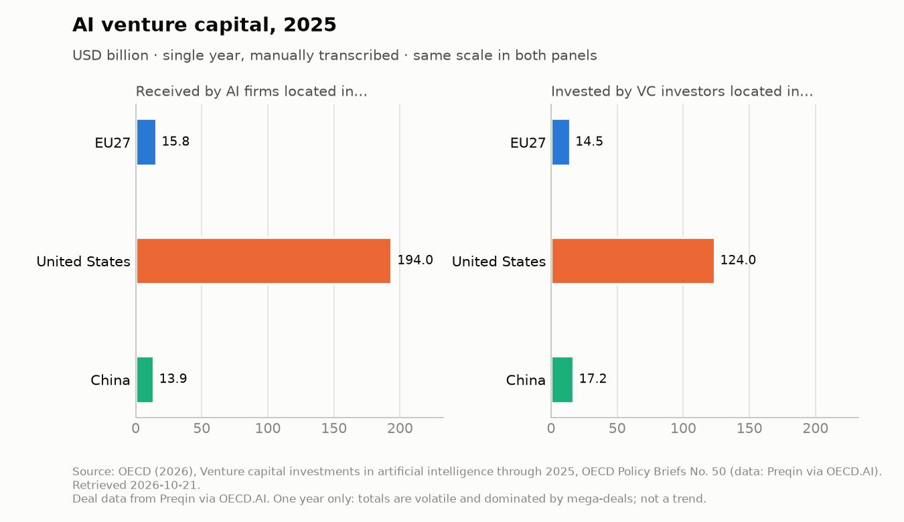
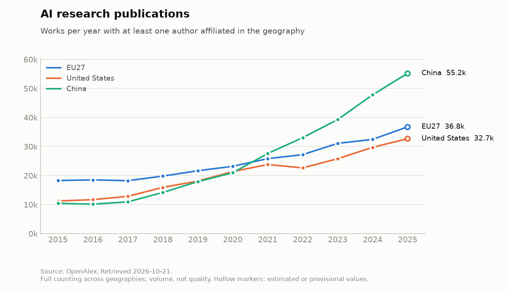
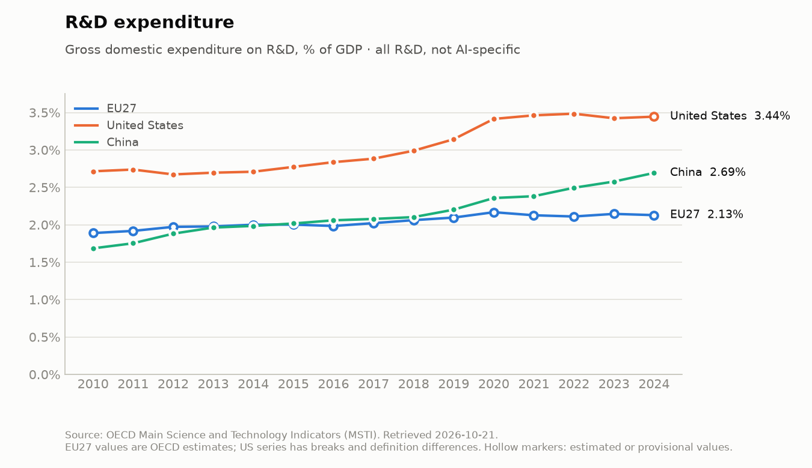
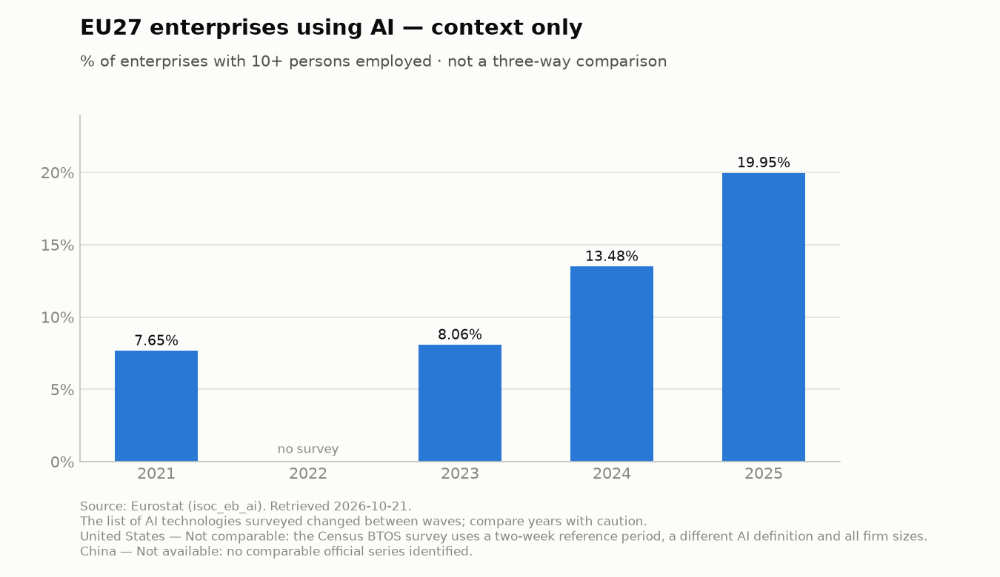

# EU vs US vs China: AI Competitiveness Tracker

**Three AI ecosystems. One transparent comparison. Follow the data.**

A Python-powered, open-source tracker comparing EU27, US, and Chinese AI ecosystems
through transparent, reproducible data.

[](https://github.com/ypsman75/ai-competitiveness-tracker/actions/workflows/tests.yml)

> **Status: v0.1.0 — evidence baseline.** Five sourced indicators, reproducible charts, a
> summary table and an offline dashboard. See [`docs/data_sources.md`](docs/data_sources.md)
> for sources, licences and caveats, and [Limitations](#limitations) before drawing conclusions.

## Scope

- **Geographies:** EU27, United States, China — used consistently; "Europe" is never
  relabelled as EU27.
- **Dimensions (planned for v0.1):** AI investment, AI research output, and one further
  comparable indicator, each with source, unit, period and caveats.
- **No composite score.** Individual metrics only.

## Setup

```bash
python -m venv .venv
source .venv/bin/activate        # Windows: .venv\Scripts\activate
python -m pip install -r requirements.txt
```

## Commands

```bash
python -m ai_competitiveness --help            # list commands
python -m ai_competitiveness.validate_data     # validate data/processed/indicators.csv
python -m ai_competitiveness.build_data --dry-run   # fetch sources, validate, show diff
python -m ai_competitiveness.build_data        # rebuild the dataset (network required)
python -m ai_competitiveness.charts            # regenerate outputs/charts/*.png
python -m ai_competitiveness.report            # write outputs/summary.md
python -m pytest                               # run tests (no network)
ruff check . && ruff format --check .          # lint
```

## Dashboard

```bash
streamlit run app/dashboard.py     # opens http://localhost:8501
```

The dashboard reads only `data/processed/indicators.csv`: no network calls, no keys, and
Streamlit telemetry is switched off in `.streamlit/config.toml`. Pick a metric to see the
EU27 / US / China comparison, hover for values and status, and expand the definition,
source, licence and methodology notes. Geographies without comparable data say why.

`build_data` needs internet access and no credentials. OpenAlex queries fit its anonymous
daily allowance; set `OPENALEX_API_KEY` (free) to use your own budget. Never commit it.

## Indicators

| Indicator | EU27 | US | China | Scope |
|---|---|---|---|---|
| AI VC received, by location of AI firm (2025, OECD/Preqin) | ✅ | ✅ | ✅ | headline |
| AI VC invested, by location of investor (2025, OECD/Preqin) | ✅ | ✅ | ✅ | headline |
| AI research publications (2015–2025, OpenAlex) | ✅ | ✅ | ✅ | headline |
| R&D expenditure, % of GDP (2010–2024, OECD MSTI) | ✅ | ✅ | ✅ | headline (not AI-specific) |
| Enterprises using AI (2021–2025, Eurostat) | ✅ | not comparable | not available | EU27 context only |

## Charts

Regenerated from `data/processed/indicators.csv`; the latest values with caveats are in
[`outputs/summary.md`](outputs/summary.md).






## Limitations

- **AI VC covers 2025 only**, transcribed from the OECD brief; the underlying Preqin series
  is not openly redistributable. One year of a volatile, mega-deal-driven market is a snapshot,
  not a trend.
- **Publications** measure volume, not quality or capability, and depend on OpenAlex's topic
  classifier. The latest year is provisional.
- **R&D intensity** is total R&D, not AI-specific. EU27 values are OECD estimates.
- **Enterprise AI adoption** is EU27-only context: no comparable US or China series exists.
- No composite score, no causal claims about policy.

## License

Code: MIT (see `LICENSE`). Data files carry their own source licences, recorded per
observation in `license_note`.
